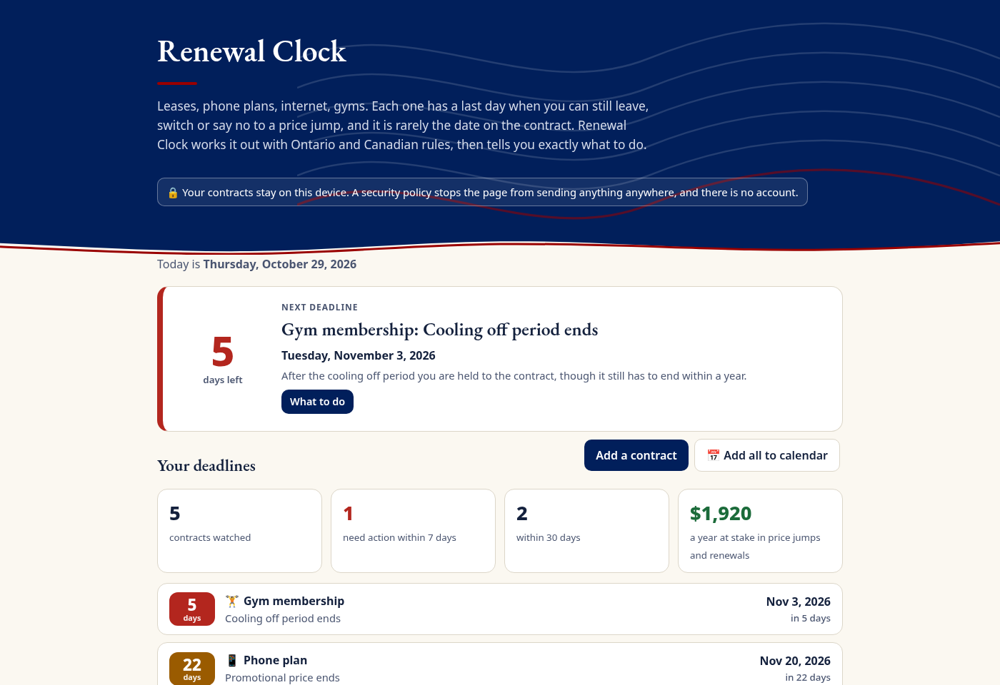

# Renewal Clock

**The last day to act on every contract you have.**

Leases, phone plans, internet, gyms. Each one has a last day when you can still leave, switch or say no to a price jump, and it is rarely the date on the contract. Renewal Clock works it out with Ontario and Canadian rules, then tells you exactly what to do.

Live: https://alenzacodes.github.io/renewal-clock/ · Video: see DEVPOST.md



## What it does

* **Ontario leases**: the last day to give Form N9 (60 days, or 28 for weekly rent, ending on the last day of a rental period), with the February and March exceptions, rent due on any day of the month, and what happens if you miss it.
* **Phone plans** (CRTC Wireless Code): trial period, promo cliff, and the early cancellation fee on any day.
* **Internet and TV** (CRTC Internet Code): the same for the large providers.
* **Ontario gyms** (Consumer Protection Act, 2002): 10 day cooling off, the one year limit, and the renewal notice window.
* **Anything else** with an end date and a notice period.
* **Paste a contract** and the reader highlights the dates and terms it found, on your device.
* Steps and a message ready to send, a twelve month timeline, money at stake, and an .ics calendar file with reminders.
* No account, no server, no tracking. Data is kept in your browser's storage, and a Content Security Policy blocks every request to another server.

## Run it

```
python3 -m http.server 8000
```

Open http://localhost:8000 and click **Try a sample household**. Add `?today=2026-10-29` to see a fixed day, as in the video.

## Test it

```
node --test                          # 16 tests: rules, reader, calendar file, security policy
python3 scripts/browser_check.py     # headless Chrome check of the whole app (needs Playwright)
python3 scripts/browser_check.py --shots   # also saves the gallery screenshots in docs/
python3 scripts/record_demo.py       # records the captioned demo
```

## How it is built

| File | What it does |
| --- | --- |
| `src/dates.js` | Date only maths in whole days, so time zones never move a deadline |
| `src/rules.js` | Each rule as a function, with its source |
| `src/plan.js` | A contract in, its deadline, timeline, steps, warnings and message out |
| `src/reader.js` | Rule based clause reader that keeps its evidence |
| `src/ics.js` | RFC 5545 calendar file with alarms and line folding |
| `src/app.js` | The interface |
| `src/sample.js` | A made up household |

## Sources

* Residential Tenancies Act, 2006: https://www.ontario.ca/laws/statute/06r17
* Landlord and Tenant Board, how a tenant can end their tenancy: https://tribunalsontario.ca/documents/ltb/Brochures/How%20a%20Tenant%20Can%20End%20Their%20Tenancy.html
* CRTC Wireless Code: https://crtc.gc.ca/eng/phone/mobile/codesimpl.htm
* CRTC Internet Code: https://crtc.gc.ca/eng/internet/codesimpl.htm
* Ontario, joining a gym or fitness club: https://www.ontario.ca/page/joining-gym-or-fitness-club

Renewal Clock explains rules and does date maths. It is not legal advice.

## Credits

Built by John Khan in Toronto, Ontario, for LaunchPad Hacks (October 2026). The page theme in `src/theme/` comes from my earlier projects. Written with help from an AI coding assistant. MIT licence.
